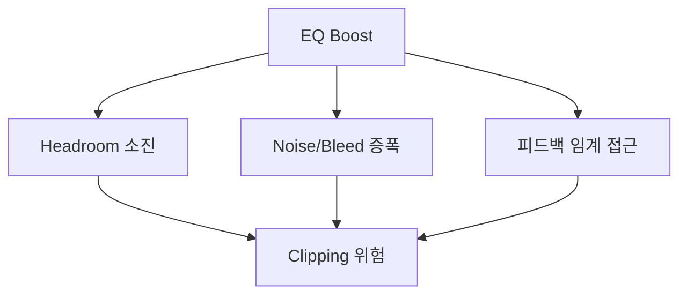

## EQ Cut 과 Boost 올바르게 사용하기

라이브 사운드에서 Equalization (EQ) 를 사용할 때 cut(감쇠) 을 기본으로 하면, headroom 을 보존하고, 피드백 위험을 줄이며, 노이즈 없는 깨끗한 믹스를 만들 수 있다. 이 가이드는 왜 cut 이 기본이어야 하는지, 그리고 boost 가 필요한 상황에서 어떻게 안전하게 적용하는지를 정리한다.

## 왜 Cut 이 기본인가

EQ 는 주파수별 볼륨 조절기다. Boost 는 해당 대역의 전기적 gain 을 높이는 행위이므로, 세 가지 문제를 동시에 일으킨다.

### 1. Headroom 소진 → Clipping

EQ boost 는 해당 대역의 레벨을 올린다. 채널 하나에서 3 dB boost 를 적용하면, 그 채널의 피크가 3 dB 높아진다. 여러 채널에서 boost 가 누적되면 summing amp 의 Headroom 이 빠르게 소진되고, Clipping 이 발생한다.

Yamaha Sound Reinforcement Handbook 은 이를 명시한다: "excessive boost may reduce system headroom, create clipping and make extreme power demands on amplifiers and loudspeakers."

### 2. SNR 저하 — 노이즈와 Bleed 증폭

고역을 boost 하면 해당 대역의 시스템 noise floor(hiss) 도 함께 올라온다. 보컬 채널에서 고역을 boost 하면 보컬의 밝기가 올라가지만, 동시에 드럼 심벌의 bleed 도 증폭된다. Signal to Noise Ratio (SNR) 가 악화되는 것이다.

반면 cut 은 원하지 않는 대역을 제거하므로 SNR 을 유지하거나 오히려 개선한다.

### 3. 피드백 임계값 접근

음향 피드백은 시스템의 주파수 응답 중 **피크가 있는 곳**에서 먼저 발생한다. Boost 는 인위적 피크를 만들어 피드백 임계값에 가까워지게 한다. 반면, subtractive EQ 로 자연 발생 피크를 깎으면 시스템 전체 gain 을 **6~10 dB 더 올릴 수 있다** — Yamaha Handbook 이 ring-out 절차에서 확인한 수치다.

## Boost 가 필요한 상황

Cut 만으로는 해결할 수 없는 경우가 있다. 다음 상황에서는 boost 가 정당화된다.

### Presence 확보 (2~5 kHz)

보컬의 자음과 명료도는 1 kHz 이상에 집중된다. 믹스에서 보컬이 묻힐 때, 325~350 Hz 를 cut 하는 것이 첫 번째 시도지만, 그래도 부족하면 2~5 kHz 대역을 **소폭 (+2~3 dB) boost**하여 presence 를 확보한다.

### 악기의 캐릭터 강조

톰의 어택감, 어쿠스틱 기타의 에어감 등 악기 고유의 캐릭터를 살리기 위해 특정 대역을 boost 할 수 있다. 이때 반드시 **wide Q(넓은 대역폭)**를 사용한다. Narrow Q boost 는 필터가 발진기처럼 동작하여 ringing 을 유발한다.

### 스피커/룸 특성 보상

특정 공간에서 고역 감쇠가 심한 경우 (공기 흡수, 거리 감쇠), 시스템 EQ 에서 고역을 소폭 boost 할 수 있다. 단, 이것은 모든 다른 튜닝 (스피커 배치, 타임 얼라인먼트, 극성 확인) 이 끝난 **가장 마지막 단계**에서만 적용한다.

## 실전 절차: Cut → Boost 워크플로우

### 1 단계: HPF 적용

저역이 필요 없는 모든 채널에 High-Pass Filter 를 건다. 보컬은 80~100 Hz, 일반 악기는 60 Hz 이상. 5~30 Hz 의 subsonic rumble 은 앰프 파워를 낭비하고 스피커를 손상시킨다.

### 2 단계: 문제 주파수 Cut

Pre-Fade Listen (PFL) 로 해당 채널을 격리 모니터링한다. 탁한 대역 (200~500 Hz), 거친 대역 (2~4 kHz), 치찰음 (6~8 kHz) 등 문제가 되는 주파수를 식별하고 cut 한다.

- Parametric EQ: high Q(좁은 대역) 로 문제 주파수를 정밀 제거
- 원칙: **narrow cut, wide boost** — cut 은 좁게, boost 가 필요하면 넓게

### 3 단계: 밸런스 재확인

Cut 만으로 원하는 톤이 나오는지 확인한다. 대부분의 경우 여기서 끝난다.

### 4 단계: 필요 시 소폭 Boost

여전히 부족하면 wide Q 로 +2~3 dB 이내에서 boost 한다.

- Boost 후 반드시 채널 미터와 Master Bus 미터를 재확인한다
- Boost 가 headroom 을 얼마나 소진했는지 직접 눈으로 확인한다
- Boost 후 피드백 경향이 생기면 즉시 되돌린다

### 5 단계: 시스템 EQ (공연 중 최종 조정)

하우스 GEQ 나 매트릭스 EQ 로 전체 시스템의 톤을 미세 조정한다. 이것은 개별 채널이 아니라 **출력 단계**에서 한다.

## 결과 확인

| 확인 항목 | 기준 |
|----------|------|
| Master Bus 피크 | -6 dB 이하 (headroom 확보) |
| 시스템 hiss | 무음 상태에서 청취 불가 |
| 피드백 마진 | 운용 레벨 대비 6 dB 이상 여유 |
| 보컬 명료도 | 자음이 악기에 묻히지 않음 |

## 핵심 요약

| Cut (기본) | Boost (예외) |
|-----------|-------------|
| Headroom 보존 | Headroom 소진 |
| SNR 유지/개선 | Noise + bleed 증폭 |
| 피드백 마진 확보 | 피드백 임계 접근 |
| Narrow Q 사용 가능 | Wide Q 만 안전 |
| 항상 먼저 시도 | Cut 으로 부족할 때만 |

> **원칙: EQ 는 " 없는 것을 더하는 도구 " 가 아니라 " 있는 것 중 불필요한 것을 제거하는 도구 " 다.**

관련 글: [[Gain과 Fader의 근본적인 차이는 무엇인가 어떻게 결정하는가]] · [[X32 고장 났을 때 예배드리는 법]]
