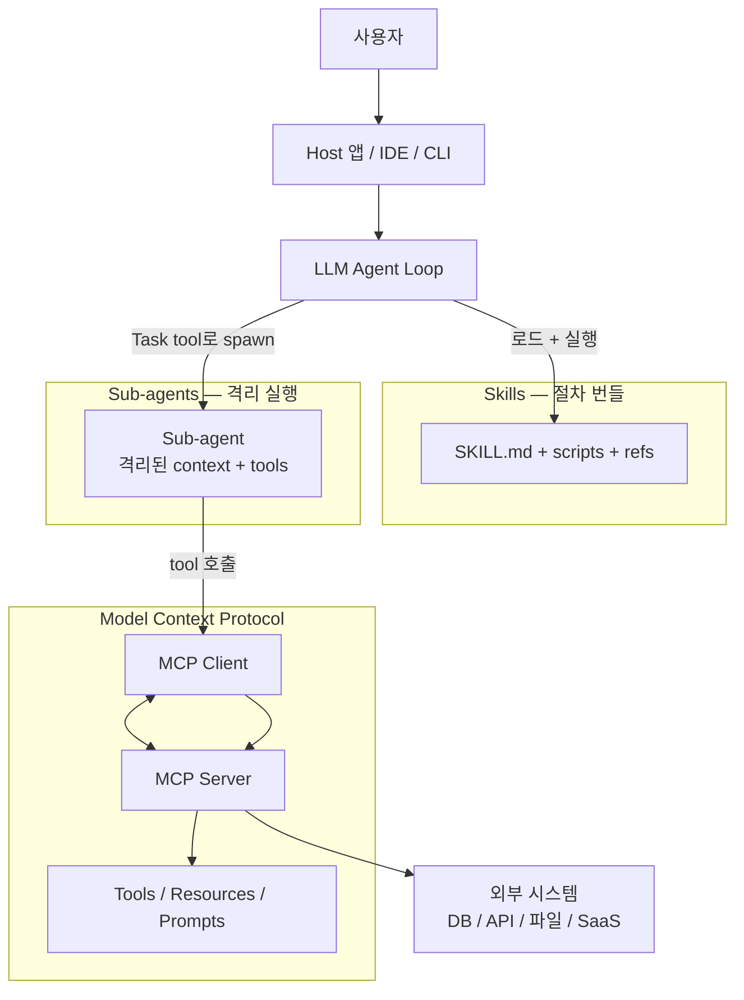
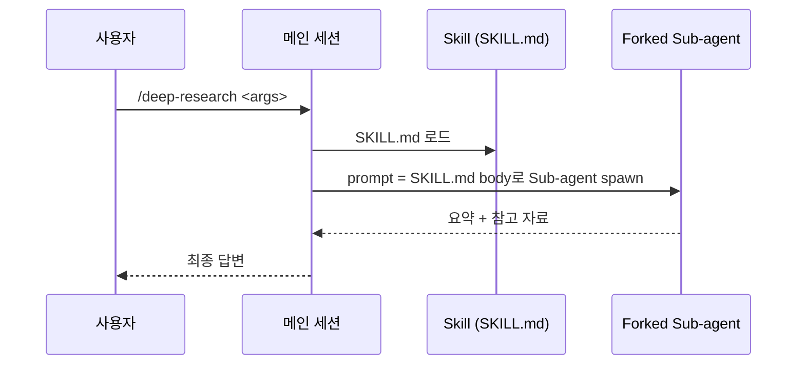
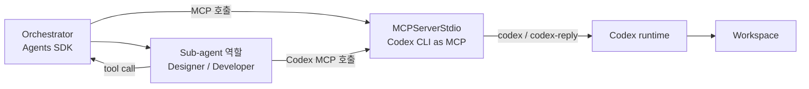

## Agentic Coding Agent 의 세 컴포넌트: Skill, MCP, Sub-agent

Claude Code 와 Codex 같은 코딩 에이전트에서 세 컴포넌트가 반복해서 등장하지만, 실제로 헷갈리는 경우가 많다. 역할은 명확히 다르다. **Skill**은 절차적 기억 (procedural memory) 의 단위다 — 재사용 가능한 워크플로를 `SKILL.md` 진입점으로 패키징한 파일 번들로, 필요할 때만 로드된다. **Model Context Protocol (MCP)** 은 외부 시스템 연결의 표준이다 — JSON-RPC 2.0 기반 클라이언트 - 서버 프로토콜로, 어떤 프레임워크에서든 tool, resource, prompt template 을 노출한다. **Sub-agent**는 격리 실행의 단위다 — 별도로 생성 (spawn) 된 에이전트 인스턴스로, 독립된 context window 와 tool 범위, 권한 모드를 가진다.

세 컴포넌트는 서로를 대체하지 않는다. 계층적으로 결합된다. Skill 은 Sub-agent 안에서 실행되고, Sub-agent 는 MCP tool 을 호출하며, MCP 는 권한 워크플로의 제어 플레인 (control plane) 까지 담당할 수 있다.

## 이 세 계층이 왜 생겼는가

AI Agent 패러다임은 ReAct(Yao et al., 2023) 가 정식화한 Thought → Action → Observation 루프를 중심으로 수렴해 왔다. 언어 모델이 추론 단계를 생성하고, tool 을 호출 (action) 하고, observation 을 받아 다음 추론에 반영하는 루프다. 단순한 작업에는 잘 작동한다. 세 가지 압력 앞에서 무너진다.

**Context 예산 고갈.** tool 정의 하나하나, 시스템 프롬프트에 주입되는 절차 지식 하나하나가 토큰을 소모한다. 수백 개의 MCP tool 이나 수십 개의 워크플로 설명이 쌓이면, 작업을 시작하기 전에 context window 가 꽉 찬다. Progressive disclosure(메타데이터만 먼저, 본문은 필요할 때만 로드) 가 Skill 과 MCP Tool Search 모두에서 핵심 설계 원칙이 된 이유다. 참고: Context Window.

**재현성과 재사용.** 애드혹 시스템 프롬프트는 버전 관리, 공유, 감사가 어렵다. 팀에는 알려진 진입점과 이름, 설명, 선택적 스크립트를 갖춘 패키징 표준이 필요했다. Agent Skills 오픈 표준이 이 공백을 채우기 위해 등장했다.

**격리와 최소 권한.** 코드베이스 탐색 → 리팩터링 제안 → 테스트 작성 → PR 제출 같은 긴 멀티스텝 작업이 하나의 context window 와 하나의 권한 세트를 공유해서는 안 된다. 3 단계의 실수가 1 단계의 추론을 망쳐서는 안 된다. Sub-agent 가 context 격리와 권한 경계를 제공하고, MCP 가 Sub-agent 가 호출할 tool 에 대한 거버넌스 (allowlist, denylist, OAuth 2.1) 를 제공한다.

## 각 컴포넌트의 역할

### Skill

Skill 은 최소한 `SKILL.md` 파일 하나를 포함하는 디렉터리다. frontmatter 의 `name` 과 `description` 이 라우팅 키 역할을 하고, body 가 워크플로 지침을 담는다. 선택적으로 `scripts/`, `references/`, `assets/` 디렉터리를 포함할 수 있다.

로딩 모델은 progressive disclosure 를 통해 context 규율을 강제한다. 에이전트 시작 시에는 메타데이터 (`name`, `description`) 만 로드된다 — 시스템이 context window 를 채우지 않고 사용 가능한 Skill 목록을 만든다. Skill 이 활성화되면 (명시적 `/skill-name` 호출 또는 description 매칭) 전체 `SKILL.md` body 가 로드된다. Skill 이 스크립트를 실행할 때는 스크립트 **출력만** context 에 들어온다 — 소스 코드 자체는 절대 들어오지 않는다.

Claude Code 는 기본 표준에 세 가지를 추가해 Skill 을 나머지 두 컴포넌트와 진정으로 결합 가능하게 만든다. 첫째, `invocation control`(`disable-model-invocation`) 은 Skill 의 자동 사용을 막아 명시적 호출을 요구한다. 둘째, `context: fork` 는 Skill body 를 Sub-agent 의 시스템 프롬프트로 만들어 완전한 격리 환경에서 실행한다. 셋째, Sub-agent 정의의 `skills` 필드는 spawn 시점에 전체 Skill body 를 미리 로드 (preload) 한다. 이 두 방향 — Skill 이 Sub-agent 로 들어가거나, Sub-agent 가 Skill 을 preload 하거나 — 이 공식적으로 양방향 결합으로 문서화되어 있다.

보안 함의가 크다. Skill 은 지침과 스크립트를 포함할 수 있다. 공식 가이드는 Skill 설치를 소프트웨어 설치와 동일하게 취급할 것을 권고한다: 신뢰하기 전에 전체 번들을 감사하라.

### MCP (Model Context Protocol)

MCP 는 LLM 애플리케이션과 외부 tool·데이터 소스를 연결하기 위한 개방형 프로토콜이다. 3 계층 아키텍처를 정의한다: Host(사용자 facing 앱) → Client(서버와의 1:1 연결 관리) → Server(primitive 노출).

세 가지 서버 primitive 는 각각 다른 제어 주체를 가진다.

| Primitive | 제어 주체 | 역할 |
|-----------|---------|------|
| **Tools** | 모델 | LLM 이 호출하는 함수 (API 호출, DB 쿼리, 파일 작업) |
| **Resources** | 애플리케이션 | 앱이 context 에 첨부하는 구조화된 데이터 (파일, 레코드) |
| **Prompts** | 사용자 | 사용자가 선택하는 파라미터화된 템플릿 |

모든 MCP 연결은 필수 수명주기로 시작한다: `initialize` → capability 협상 → `initialized` 알림 → 운영. 이는 선택 사항이 아니다 — 어떤 tool 호출도 발생하기 전에 버전 호환성과 capability 교환을 강제한다.

표준 전송 (transport) 은 두 가지다. `stdio` 는 로컬 tool 에 최적이다: 클라이언트가 서버를 서브프로세스로 실행하고 stdin/stdout 으로 newline 구분 JSON-RPC 를 주고받는다. Streamable HTTP 는 원격 또는 멀티테넌트 환경에 권장된다; SSE 는 Claude Code 에서 deprecated 다.

Authorization 은 스펙상 선택이지만, 민감한 데이터·감사 요건·엔터프라이즈 접근 제어에는 강력 권고된다. HTTP 기반 서버는 OAuth 2.1 관례를 따라야 한다. 공식 Security Best Practices 문서는 구체적인 공격면을 열거한다: Confused Deputy, SSRF, Session Hijacking, Local MCP Server compromise.

제품 레벨에서 Claude Code 의 allowlist 와 denylist 는 허용된 서버 커맨드 (stdio) 와 URL 패턴 (HTTP) 을 강제한다. MCP tool 은 permission prompt 핸들러로도 지정될 수 있다 — 즉 MCP 가 tool 레이어를 넘어 제어 플레인에 진입한다.

**Skill 을 MCP 로 매핑하는 방식:** 공식 1:1 표준은 없다. 실무에서는 Skill 의 실행 기능이 MCP Tool 로, Skill 의 절차 템플릿이 MCP Prompt 로 매핑된다. 이를 통해 Skill 형태의 capability 를 표준화된 크로스 프레임워크 레지스트리에 거버넌스와 감사 가능성을 붙여 배포할 수 있다.

### Sub-agent

Sub-agent 는 메인 에이전트가 하위 작업 처리를 위해 생성하는 별도 에이전트 인스턴스다. 각 인스턴스는 독립된 context window(메인 대화와 격리), 커스텀 시스템 프롬프트, 정의된 tool 범위 (`tools` allowlist 또는 `disallowedTools` denylist), 독립적 `permissionMode`, 그리고 선택적 `memory` 필드 (spawn 시 `MEMORY.md` 가 시스템 프롬프트에 주입되는 persistent 디렉터리; memory 활성화 시 Read/Write/Edit tool 이 자동 활성화) 를 가진다.

기본적으로 Sub-agent 는 메인 세션의 모든 tool 을 상속한다 — MCP tool 포함. 이는 Sub-agent 가 자연스럽게 MCP 로 연결된 외부 시스템의 역할 특화 실행기 (role-specialized executor) 가 됨을 의미한다. `Task` tool 자체도 제어 가능하다: 어떤 `agent_type` 값을 spawn 할 수 있는지 제한하거나, Task 를 완전히 제거해 추가 spawning 을 막을 수 있다.

Codex 에서는 제품이 Sub-agent 스레드를 관리한다: spawn, 후속 지시 라우팅, 결과 대기, 응답 통합, 스레드 종료. CLI 는 `/agent` 로 실행 중인 Sub-agent 를 검사하거나 조종한다.

관련 패턴들의 차이:

| 패턴 | 정의 | 상태 이전 |
|------|------|---------|
| **Sub-agent** (Claude/Codex) | Spawn 된 인스턴스; 결과 요약을 부모에게 반환 | 격리; 요약만 반환 |
| **Handoff** (OpenAI SDK) | 다른 에이전트로의 단방향 이전; tool call 로 구현 | 최신 대화 상태 이전 |
| **Agent-as-tool** (OpenAI SDK) | 완전한 handoff 없이 에이전트를 callable tool 로 노출 | 중첩 호출; 결과 반환 |

## 결합 패턴

### 전체 아키텍처

### Skill + Sub-agent

Skill frontmatter 의 `context: fork` 가 Skill body 를 Sub-agent 의 시스템 프롬프트로 만든다. Sub-agent 는 새 context 에서 실행되며 메인 대화 히스토리를 볼 수 없다.

**적합한 경우:** 메인 context 오염이 추론 품질을 저하시킬 수 있는 긴 탐색·분석 작업.

### Skill + MCP

Skill 이 절차 지침을 제공하고, MCP 가 외부 시스템의 실행 표면을 제공한다. MCP tool 이 많을 때 MCP Tool Search 는 Skill progressive disclosure 를 그대로 반영한다 — tool 정의가 시작 시 context 를 채우지 않고 필요할 때 로드된다.

사례: KakaoPay 는 결제 API 연동에 MCP 를 선택했다. 동일한 8 개 tool 이 LangChain, OpenAI SDK, Vercel AI SDK 클라이언트 모두를 서빙하기 때문이다 — 프레임워크별 코드 없이. MCP 가 모든 연동의 authorization 과 감사를 위한 단일 거버넌스 포인트가 됐다.

### MCP + Sub-agent

Sub-agent 는 기본적으로 MCP tool 을 상속한다. Codex + OpenAI Agents SDK 에서는 Codex CLI 자체가 MCP 서버로 래핑된다 — `codex()` 와 `codex-reply()` tool 을 노출하며 — 여러 역할 특화 에이전트 (Designer, Developer 등) 가 각각 그 MCP 서버를 공유 실행 엔진으로 호출한다.

**적합한 경우:** 쓰기·삭제·결제처럼 프로토콜 레벨에서 역할 기반 최소 권한이 필요한 고신뢰 작업에 병렬 실행을 결합할 때.

## 언제 무엇을 선택할까

**Skill 을 선택하는 경우:** 지침과 스크립트로 표현 가능한 반복 워크플로가 있을 때. Context 규율 (progressive disclosure) 이 필요할 때. 팀이 워크플로를 코드처럼 공유하고 버전 관리해야 할 때.

**MCP 를 선택하는 경우:** 여러 프레임워크나 호스트에서 동일한 tool 을 사용해야 할 때. 외부 시스템 접근이 필요할 때. 조직 정책이 단일 집행 포인트를 필요로 할 때. *주의: HTTP MCP 는 OAuth 2.1 과 그 전체 공격면 (SSRF, session hijack) 을 운영 책임으로 가져온다.*

**Sub-agent 를 선택하는 경우:** 작업이 길거나 멀티스텝이어서 메인 context 를 오염시킬 때. 역할 또는 권한 분리가 필요할 때. 독립적인 하위 작업의 병렬 실행으로 wall-clock time 을 줄일 수 있을 때. *주의: `memory` 활성화는 Read/Write/Edit 을 자동 활성화한다; 지속성이 필요한 에이전트에만 memory 를 부여하라.*

| 질문 | 예인가? | 선택 |
|------|---------|------|
| 반복 워크플로를 파일 번들로 관리하면 재사용성이 높아지는가? | 예 | Skill |
| 외부 시스템 접근이 필요한가? | 예 | MCP Tool |
| 여러 프레임워크가 동일 tool 을 공유해야 하는가? | 예 | MCP + authorization |
| 메인 context 오염 또는 병렬 분업이 필요한가? | 예 | Sub-agent |
| 쓰기·삭제·결제 레벨 권한을 최소화해야 하는가? | 예 | Sub-agent `permissionMode` + MCP `allowlist` |
| Tool 정의가 너무 많아 context 를 잠식하는가? | 예 | Skill progressive disclosure 또는 MCP Tool Search |
| 승인 워크플로가 필수인가? | 예 | MCP 를 permission handler 로 |

## 플랫폼별 비교

| 플랫폼 | Skill | Sub-agent | MCP |
|--------|-------|-----------|-----|
| **Claude Code** | `SKILL.md`, `context: fork`, `invocation control`, `skills` preload | `memory`, `maxTurns`, `permissionMode`, 기본적으로 MCP tool 상속 | HTTP 권장, SSE deprecated, `.mcp.json` 플러그인 번들, Tool Search, allowlist/denylist |
| **Codex** | Agent Skills 표준, progressive disclosure, 명시/암묵 활성화 | 제품이 spawn/스레드/결과 통합 관리, `/agent` 로 제어 | Codex CLI 를 Agents SDK 용 MCP 서버로 래핑 |
| **OpenAI Agents SDK** | `environment.skills`, 컨테이너 번들 주입 | Handoffs (LLM 에 보이는 tool) + agents-as-tools + sessions | MCP 서버 유틸리티 |

## 관련 개념

- Model Context Protocol (MCP) — Skill 의 절차는 MCP Prompt 로, 실행 기능은 MCP Tool 로 매핑해 외부에 노출한다
- AI Agent — Sub-agent 는 AI Agent 의 분업 실행 단위; Skill 은 agent loop 에 주입되는 절차 지식 레이어
- Claude Code — Skill + MCP + Sub-agent 를 공식적으로 통합한 대표 coding agent 구현체
- Context Window — Skill progressive disclosure 와 MCP Tool Search 는 동일한 context budget 문제에 대한 각각의 해법
- Prompt Engineering — Skill body 는 구조화된 system prompt 의 번들 형태

관련 글: [[Agent 의 매뉴얼, 나만의 Skill 만들기]] · [[비공식 OSC 문서를 테스트로 바꿔 만든 X32 MCP 서버]]
